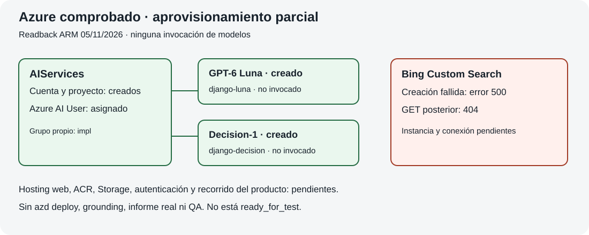

# Django Upgrade Evidence

Aplicación Django para preparar una actualización de Django con evidencia por versión. Recibe una versión final `X.Y.Z`, conserva metadatos de fuentes oficiales y delega la decisión tipada a un adaptador de Microsoft Foundry cuando Azure está configurado.

## Estado de esta entrega

Esta es la implementación local inicial. Incluye interfaz, backend, validación, metadatos de fuentes, exportación HTML/JSON, pruebas y el adaptador REST. No se ha ejecutado `azd provision`, `azd deploy`, Bing Custom Search, Microsoft-Decision-1 ni una llamada pagada. Sin configuración Azure, la aplicación devuelve `needs_configuration`; nunca muestra un resultado simulado.

## Ejecutar localmente

Requiere Python 3.11+.

```bash
uv venv
uv sync
cp .env.example .env
uv run python manage.py runserver
```

Abre http://127.0.0.1:8000. Las comprobaciones locales son:

```bash
uv run python manage.py check
uv run python manage.py test
```

El servidor `runserver` es sólo para desarrollo. La aplicación mantiene los informes en memoria durante la sesión local; no se presenta persistencia como disponible hasta definir el almacenamiento Azure aprobado.

## Integración Azure preparada, no activada

El adaptador exige `AZURE_FOUNDRY_ENDPOINT`, `AZURE_DECISION_DEPLOYMENT` y `AZURE_DECISION_ENDPOINT`. Usa Azure Identity en backend (`AzureCliCredential` para operador local o `ManagedIdentityCredential` para hosting) y pide el scope `https://ai.azure.com/.default`. La configuración de Bing y Decision-1, el proyecto Foundry, región, cuota, roles y recurso exactos deben quedar fijados en un plan cloud separado; no se guardan tokens ni endpoints firmados.

El flujo previsto es: validar versión → recuperar documentos oficiales permitidos y registrar URL/fecha/hash → enviar evidencia estructurada al agente Foundry con grounding autorizado → revisar campos → llamar Decision-1 → exportar informe con incertidumbre. La ausencia de una rama o fuente no se convierte en seguridad.

## Arquitectura



## Datos y límites

Sólo se acepta una versión Django final por solicitud. Las fuentes están limitadas a `docs.djangoproject.com`, `www.djangoproject.com` y `pypi.org`; se bloquean credenciales en URLs, redirecciones fuera de la allowlist y documentos de más de 512 KiB. No se envía código del usuario ni un fichero requirements.

## Retirada

Antes de cualquier despliegue real se debe registrar el inventario de recursos exclusivos, datos retenidos, respuestas de Foundry, configuración de Bing y roles. La retirada será una solicitud separada; este repositorio no borra recursos ni cambia permisos.
