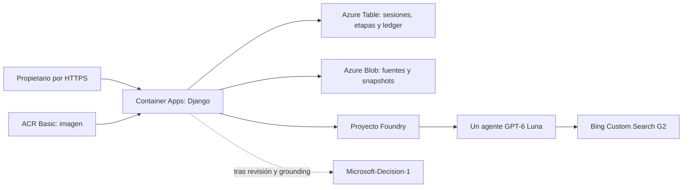

# Django Upgrade Evidence

Web privada para preparar una actualización de Django a partir de fuentes oficiales. Recibe una versión final X.Y.Z, conserva un lote con fecha/hash, propone evidencia con un agente Foundry y Bing Custom Search, permite corregirla y pide una decisión numérica a Microsoft-Decision-1. No modifica dependencias ni repositorios.

Requiere una instalación propia en Azure con Bing Custom Search G2, proyecto Foundry y los dos modelos. El agente es único por entorno y se reutiliza entre análisis; cada análisis conserva su thread/run y sus reservas. La salida depende de evidencia oficial y revisión explícita: un fallo o incertidumbre nunca se sustituye por datos simulados. [Configuración, diagnóstico y fuentes oficiales Bing](docs/bing-setup.md).

## Requisitos

Acceso al repositorio GitHub privado; Git, Python3.11+, uv, Azure CLI, azd1.34.2 o compatible. No requiere Docker local: la imagen se construye en ACR. Las versiones de Python/SDK están fijadas por uv.lock y requirements.lock, incluidos Django5.2.19 y Projects2.10.0. Agents1.2.0b6 se conserva sólo para leer históricos clásicos y detectar una migración pendiente. No copiar código del repositorio de referencia: no se identificó licencia.

Azure propio: una suscripción con presupuesto y cuota para Luna y Decision-1 en West Europe, permisos para crear recursos y asignar roles sobre su grupo exclusivo. El operador necesita acceso de datos a su Storage; el Bicep concede sólo Blob/Table en esa cuenta. La identidad de la web recibe Blob/Table propios, Azure AI User en su AIServices y AcrPull en su ACR. Sin registros de aplicación Entra, claves de Storage o Log Analytics.

El operador debe seleccionar también su suscripción en Azure CLI con `az account set --subscription <suscripcion-propia>`. Los helpers de propietario sustituyen sólo las variables públicas por las del entorno azd seleccionado, evitando reutilizar endpoints de otro entorno.

## Instalar y configurar un entorno propio

```sh
uv sync --frozen
az login
AZURE_DEV_USER_AGENT=microsoft_foundry_skill azd auth login
AZURE_DEV_USER_AGENT=microsoft_foundry_skill azd env new django-evidence-reader
AZURE_DEV_USER_AGENT=microsoft_foundry_skill azd env set AZURE_SUBSCRIPTION_ID <suscripcion-propia>
AZURE_DEV_USER_AGENT=microsoft_foundry_skill azd env set AZURE_LOCATION westeurope
AZURE_DEV_USER_AGENT=microsoft_foundry_skill azd env set AZURE_RESOURCE_GROUP rg-django-evidence-reader
az ad signed-in-user show --query id --output tsv
AZURE_DEV_USER_AGENT=microsoft_foundry_skill azd env set AZURE_PRINCIPAL_ID <object-id-del-usuario>
AZURE_DEV_USER_AGENT=microsoft_foundry_skill azd env set CLEANUP_AT <fecha-ISO-con-zona-de-tu-plan>
AZURE_DEV_USER_AGENT=microsoft_foundry_skill azd env set LAB_EXPIRES_AT <fin-ISO-del-consumo-autorizado>
```

Sustituye los marcadores. Son identificadores y fechas públicos, no claves. Confirma la suscripción, región, cuota, presupuesto, grupo y ventana antes de efectos. LAB_EXPIRES_AT debe terminar como máximo en CLEANUP_AT; la caducidad de un grant reservado para cierre no amplía la ventana de consumo. Nunca uses otro laboratorio o un grupo compartido. No depende de archivos, endpoints o recursos privados del autor: las salidas de tu propio azd configuran los clientes.

La copia Tester de este ciclo debe usar exactamente entorno `mvp-django-20261105-qa` y grupo `rg-mvp-django-20261105-qa`, con la suscripción de su plan aprobado. Implementer usa los nombres impl. Los recursos hijos se derivan del grupo/entorno, de modo que las copias no comparten IA, almacenamiento, identidad o web. No crees el grupo QA desde el rol Implementer.

## Aprovisionar y desplegar

La configuración por defecto crea Bing Custom Search G2, la instancia django-official limitada a Django/PyPI y su conexión de proyecto. Para aprovisionar únicamente los componentes independientes:

```sh
AZURE_DEV_USER_AGENT=microsoft_foundry_skill azd env set PROVISION_GROUNDING false
```

Esto mantiene bloqueadas las llamadas del producto que necesitan grounding; no habilita un modo simulado. Para el recorrido completo, establece PROVISION_GROUNDING true dentro de una ventana de despliegue autorizada. Bicep crea también la instancia; no requiere una configuración privada del autor ni sustituye el servicio.

```sh
AZURE_DEV_USER_AGENT=microsoft_foundry_skill azd provision --preview --no-prompt
AZURE_DEV_USER_AGENT=microsoft_foundry_skill azd provision --no-prompt
AZURE_DEV_USER_AGENT=microsoft_foundry_skill azd env set SOURCE_COMMIT <SHA-de-git-rev-parse-HEAD>
AZURE_DEV_USER_AGENT=microsoft_foundry_skill azd deploy web --no-prompt
```

Primero provision, después deploy. No se ha validado azd up. `azd package` con remoteBuild puede devolver “No artifacts”; eso no acredita una imagen: el build remoto ocurre en deploy. Comprueba el resultado ACR y la revisión Container Apps. El argumento SOURCE_COMMIT es público; queda en el label OCI y en /health/. No introduzcas secretos como argumentos de build.

Si azd falla al leer el log ACR con BlobNotFound, consulta el mismo task con `az acr task show-run`. No repitas el build: cuando ese task confirme Succeeded, comprueba su etiqueta/digest y despliega el artefacto existente con `AZURE_DEV_USER_AGENT=microsoft_foundry_skill azd deploy web --from-package <imagen-ACR-exacta> --no-prompt`. Un task Queued o Running todavía no acredita una imagen.

Al actualizar una instalación existente, fija SERVICE_WEB_IMAGE a la imagen actual de esa misma Container App antes de provision. Así se conserva el producto real durante el cambio de infraestructura. Usa sólo el grupo y recursos de tu entorno; deploy publicará después la imagen del SHA nuevo.

Los outputs SERVICE_WEB_ENDPOINT_URL y AZURE_STORAGE_ACCOUNT pertenecen a tu instalación. Azure mantiene la clave Django como secreto del recurso, sin outputs; las claves locales de AIServices y Storage están deshabilitadas. .azure y .env están excluidos de Git/Docker. `.env.example` documenta nombres públicos; no se cargan archivos .env automáticamente.

## Inicializar al propietario y entrar

Desde el mismo entorno azd ya aprovisionado:

```sh
uv run python scripts/owner.py
```

Lee únicamente outputs públicos de azd; solicita usuario y contraseña por entrada protegida. Usa una contraseña de al menos16 caracteres. Sólo persiste su hash en Azure Table. Las cookies de sesión permanecen en memoria del cliente/navegador; el backend almacena un hash del identificador y una caducidad de una hora. Cambiar el propietario invalida las sesiones anteriores por generación. En un entorno de verificación con propietario temporal, usa el mismo script para establecer tu credencial antes de entrar.

Abre SERVICE_WEB_ENDPOINT_URL e inicia sesión. Un acceso anónimo a informes/API devuelve401 y la web redirige al login. Las mutaciones requieren CSRF; se limita el login a5 intentos/15min. El logout revoca la sesión en servidor. La aplicación no tiene registro abierto de usuarios.

Cliente alternativo por API, sin cookies ni contraseñas en disco:

```sh
uv run python scripts/client.py --url <SERVICE_WEB_ENDPOINT_URL>
```

La contraseña entra por getpass. El cliente mantiene una sesión en memoria y ofrece prepare/show/ground/reconcile/review/decide/close. No sigue redirecciones fuera del origen. No uses curl con tokens en argumentos o cookies persistidas.

## Recorrido y resultados

1. Introduce una versión final, por ejemplo5.2.18. Rangos, prereleases, otros tipos y versiones inválidas se rechazan antes de llamadas pagadas.
2. “Preparar lote oficial” obtiene documentos reales: archivo de seguridad, descargas/soporte, aviso del03/11/2026, PyPI para esa versión y notas5.2.19/6.0.10. Blob conserva documentos y snapshots; Table conserva punteros, sesiones, etapas y reservas. Se muestran URL/fecha/SHA-256 y fragmentos con elisiones explícitas. Un lote fechado no acredita cobertura de avisos posteriores.
3. Con Bing disponible, “Buscar con Bing y extraer evidencia” inicia una sola etapa persistida. El agente usa Luna y la instancia oficial, con una consulta breve sobre las publicaciones de seguridad de Django. Devuelve una frase de grounding con citas nativas seguida del JSON; el formato no obliga a esconder las citas dentro del JSON. Conserva las citas de páginas originales y los enlaces de consulta si el servicio los devuelve; Custom Search no exige ese enlace ni lo reconstruye desde URLs internas. HTTP no reemplaza la búsqueda. Un resultado sin búsqueda real, sin citas oficiales o incompleto queda bloqueado.
4. Revisa el JSON por CVE y rama, confirma/corrige y explica el motivo. Campos críticos requieren fragmentos exactos del lote. El comparador usa tuplas numéricas: diferencia afectación documentada, corrección y aplicabilidad no resuelta. No inventa un límite inferior ni traslada parches de rama. Condiciones como GDAL desconocido permanecen abiertas.
   Una extracción original con campos inválidos se conserva y permite corrección humana sin otra búsqueda; nunca se usa para decidir hasta validarla. HTML y JSON distinguen los campos originales, la evidencia revisada y el motivo. El contexto del agente incluye los tres avisos del archivo de seguridad, el párrafo de cada versión corregida, los CVEs presentes realmente en cada documento y la condición de GDAL, en vez de cortar sólo el principio de cada página. Las citas nativas de Bing y las citas de campos del lote capturado se identifican por separado: un resultado de búsqueda antiguo no acredita los avisos actuales ni invalida sus documentos oficiales capturados.
5. “Solicitar decisión tipada” envía el estado revisado a la API systemone. Noul es una probabilidad0–1, choice conserva su opción/distribución y score su valor decimal/escala0–3. Sin evidencia suficiente no hay urgencia accionable. Los umbrales son una política de referencia sin calibración y nunca instalan una actualización.
6. Descargar HTML/JSON o recargar reutiliza el estado; no repite inferencias. Una corrección conserva el original y vuelve obsoleta la decisión anterior; recalcular es una acción explícita con otra reserva.

El lote de aceptación se documenta en docs/acceptance-corpus.json; sus expectativas se prepararon leyendo fuentes oficiales antes de inferencia, no son PASS. Una ausencia de5.2 en un aviso o una corrección Django con GDAL desconocido no se convierten en seguridad.

## Errores y recuperación

Cada solicitud usa un UUID idempotente. “Consultar la etapa existente” sólo lee la respuesta persistida; no vuelve a crearla. Azure usa retry_total0 y el cliente Responses max_retries0. El ID se guarda desde el primer evento response.created, con ejecución background y store; se recupera por GET aunque se cierre el stream. Ante timeout sin ID se conserva la incertidumbre y la reserva, sin reenviar. Una decisión incierta tampoco se recupera volviendo a leer la extracción anterior ni se reenvía.

Una instalación nueva crea un único agente prompt y lo reutiliza, fijando su versión en cada respuesta. Si existe un agente clásico, se bloquea la migración automática: el operador debe comprobar sus runs terminales, conservar definición/evidencia y retirar sólo ese agente propio antes de activar el nuevo. Nunca se adoptan agentes ajenos ni se mantienen dos agentes para el mismo entorno.

Un error de fuente deja un fallo recuperable sin llamadas a modelos. Puedes cerrar un análisis que no esté activo/incierto para liberar su bloqueo. Una operación incierta requiere conciliación del operador antes de otra ejecución. La ausencia de almacenamiento o Bing devuelve un mensaje específico, sin resultado inventado.

## Arquitectura



El diagrama representa los servicios configurados. El resultado de una consulta y la revisión del usuario se verifican en el recorrido real; crear recursos no acredita una respuesta. /health/ devuelve el SHA de la imagen efectiva.

## Adaptaciones y límites

[Tutorial base](https://techcommunity.microsoft.com/blog/azure-ai-foundry-blog/build-a-grounded-package-upgrade-advisor-with-microsoft-decision-1/4568374). GPT-6 Luna2026-09-22 sustituye al modelo generativo del ejemplo por selección de la propuesta. Se usa el agente prompt actual de Projects2.10/APIv1 y Responses, con bing_custom_search_preview, max_tool_calls1, count1, max_output_tokens1000(incluye razonamiento) y effort none para la extracción compacta. El contexto propio se acota a8000bytes y se rechaza una respuesta con uso agregado superior a6000 tokens de entrada o1000 de salida. El servicio incorpora contexto Bing: no existe un límite de entrada equivalente a max_prompt_tokens en Responses y esa comprobación de uso no es un hard cap de factura. Compatibilidad y resultado se comprueban con una llamada real, no por catálogo. El cliente retiene IDs, exige uso/citas y permite releer la misma respuesta tras un fallo de interpretación. No acepta output incompleto ni amplía tokens o reenvía inferencia automáticamente. [Migración oficial](https://learn.microsoft.com/en-us/azure/foundry/agents/how-to/migrate).

Cada entorno reserva conservadoramente hasta5 llamadas internas/3 búsquedas por grounding y1 por decisión; su ledger persiste entre reinicios/runs. El ciclo limita40 invocaciones y24 búsquedas, incluyendo internas/diagnósticos. Los valores por defecto son12/6. La continuación aprobada asigna16/6 al autor y24/12 al Tester: las2 llamadas históricas ya están en el ledger del autor, por lo que quedan como máximo38 nuevas entre ambos entornos. No reiniciar contadores ni aumentar límites para eludir reservas. El ledger y escala0–1 no son un hard cap de factura. El consumo termina11/11/2026 09:00Z; el cierre hasta11:00Z no permite nuevas llamadas. Cada instalación propia debe fijar sus fechas y presupuesto.

Una conciliación operativa puede liberar sólo la parte probadamente no usada de una reserva terminal. Conserva los contadores acumulados y la reserva original; añade un registro con ID único, padre, cantidades no usadas y evidencia del run/uso/pasos. La comprobación del límite descuenta esas partidas itemizadas y rechaza duplicados, reservas desconocidas, valores negativos o liberaciones superiores al original. No hay endpoint web para introducir conciliaciones. Una reserva monetaria del ciclo o la factura Azure no se libera con este mecanismo. Las correcciones explícitas conservan sus IDs/consumo; no hay reintentos pagados automáticos.

Para los cuatro casos por versión del Tester, su entorno aislado fija MODEL_CALL_LIMIT=24 y BING_QUERY_LIMIT=12 antes de provision. Autor y Tester leen los dos ledgers antes de reservar correcciones/retests; un límite insuficiente bloquea una nueva llamada. Las asignaciones conservadoras no garantizan cubrir un número de repeticiones si se agotan los topes.

Las notas por versión se capturan desde el párrafo “Django X.Y.Z fixes”, no desde el título repetido en navegación. Un CVE ausente de las notas de una corrección no hereda ese parche. Si la opción de Decision-1 contradice la afectación determinista o ignora condiciones críticas, se conserva su valor pero se bloquea la urgencia accionable y se señala la discrepancia.

Cada web:0,25vCPU/0,5GiB, mínimo0/máximo1, una revisión activa; ACR Basic, Storage LRS y modelos DataZoneStandard. La continuación acota16 replica-h adicionales/entorno,2d de ACR/Storage y6 builds adicionales conjuntos de20vCPU-min. Estimación adicional3,94EUR, techo adicional3,95 y4,05 reservados anteriores: agregado≤8EUR del laboratorio, sin impuestos cotizados. Esto no autoriza otra suscripción. Modelos/grounding, registro, almacenamiento y réplicas pueden generar coste; reservas y facturación se concilian por separado.

Retirada de la continuación:11/11/2026 10:00 Europe/Madrid. Cada instalación propia usa la fecha de su plan, que no se renueva por reintento. Con autorización aplicable, comprueba el inventario/grupo exacto y usa `AZURE_DEV_USER_AGENT=microsoft_foundry_skill azd down`. Nunca borres repositorio, grupos ajenos o recursos compartidos. No se crean programaciones desde esta aplicación.

## Desarrollo

```sh
uv run python manage.py collectstatic --noinput
uv run python manage.py check
uv run python manage.py test
```

Las pruebas locales usan dobles sólo en tests/; no se incluyen en la imagen ni acreditan cloud o QA Tester. Para desarrollo con Azure real, configura AZURE_STORAGE_ACCOUNT de tu entorno y AzureCliCredential; runserver sólo se enlaza a127.0.0.1. El producto no tiene almacenamiento local ni fixtures de demostración.

Fragmentos Django: atribución a Django Software Foundation y colaboradores; licencia en docs/DJANGO-LICENSE. Las páginas weblog se enlazan y muestran extractos limitados, no se ofrecen como corpus público redistribuido. Requisitos de Bing: [citas y condiciones](https://learn.microsoft.com/en-us/azure/foundry/agents/how-to/tools/bing-tools). API Decision-1: [contrato específico](https://learn.microsoft.com/en-us/azure/foundry/foundry-models/how-to/use-foundry-models-microsoft-decision).
