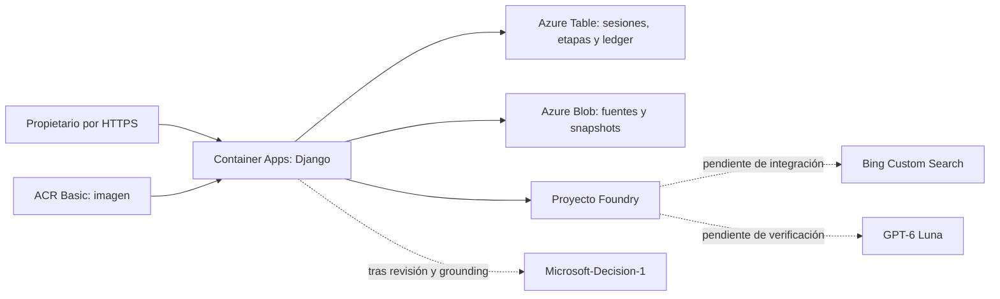

# Django Upgrade Evidence

Web privada para preparar una actualización de Django a partir de fuentes oficiales. Recibe una versión final X.Y.Z, conserva un lote con fecha/hash, propone evidencia con un agente Foundry y Bing Custom Search, permite corregirla y pide una decisión numérica a Microsoft-Decision-1. No modifica dependencias ni repositorios.

**Estado: integración end-to-end pendiente.** La revisión incluye autenticación, Azure Blob/Table, revisión/comparador, obsolescencia e informes HTML/JSON y despliegue azd. Bing Custom Search ha fallado al crearse en la suscripción del laboratorio con error500; no se sustituye por HTTP ni por Bing estándar. Mientras falte esa conexión, se pueden preparar fuentes reales pero no obtener una decisión final del recorrido. No está ready_for_test y no tiene QA PASS.

## Requisitos

Acceso al repositorio GitHub privado; Git, Python3.11+, uv, Azure CLI, azd1.34.2 o compatible. No requiere Docker local: la imagen se construye en ACR. Las versiones de Python/SDK están fijadas por uv.lock y requirements.lock, incluidos Django5.2.19, Azure Agents1.2.0b6 y Projects2.0.0b2. No copiar código del repositorio de referencia: no se identificó licencia.

Azure propio: una suscripción con presupuesto y cuota para Luna y Decision-1 en West Europe, permisos para crear recursos y asignar roles sobre su grupo exclusivo. El operador necesita acceso de datos a su Storage; el Bicep concede sólo Blob/Table en esa cuenta. La identidad de la web recibe Blob/Table propios, Azure AI User en su AIServices y AcrPull en su ACR. Sin registros de aplicación Entra, claves de Storage o Log Analytics.

El operador debe seleccionar también su suscripción en Azure CLI con `az account set --subscription <suscripcion-propia>`. Los helpers de propietario sustituyen sólo las variables públicas por las del entorno azd seleccionado, evitando reutilizar endpoints de otro entorno.

## Instalar y configurar un entorno propio

```sh
uv sync --frozen
az login
AZURE_DEV_USER_AGENT=microsoft_foundry_skill azd auth login
AZURE_DEV_USER_AGENT=microsoft_foundry_skill azd env new django-evidence-reader
AZURE_DEV_USER_AGENT=microsoft_foundry_skill azd env set AZURE_SUBSCRIPTION_ID <suscripcion-propia>
AZURE_DEV_USER_AGENT=microsoft_foundry_skill azd env set AZURE_LOCATION westeurope
AZURE_DEV_USER_AGENT=microsoft_foundry_skill azd env set AZURE_RESOURCE_GROUP rg-django-evidence-reader
az ad signed-in-user show --query id --output tsv
AZURE_DEV_USER_AGENT=microsoft_foundry_skill azd env set AZURE_PRINCIPAL_ID <object-id-del-usuario>
```

Sustituye los marcadores. Son identificadores públicos, no claves. Confirma la suscripción, región, cuota, presupuesto y grupo antes de efectos. Nunca uses otro laboratorio o un grupo compartido. No depende de archivos, endpoints o recursos privados del autor: las salidas de tu propio azd configuran los clientes.

La copia Tester de este ciclo debe usar exactamente entorno `mvp-django-20261105-qa` y grupo `rg-mvp-django-20261105-qa`, con la suscripción de su plan aprobado. Implementer usa los nombres impl. Los recursos hijos se derivan del grupo/entorno, de modo que las copias no comparten IA, almacenamiento, identidad o web. No crees el grupo QA desde el rol Implementer.

## Aprovisionar y desplegar

La configuración por defecto intenta también crear Bing Custom Search. En la suscripción donde se observó su fallo, para avanzar únicamente con la infraestructura independiente:

```sh
AZURE_DEV_USER_AGENT=microsoft_foundry_skill azd env set PROVISION_GROUNDING false
```

Esto mantiene bloqueadas las llamadas del producto que necesitan grounding; no habilita un modo simulado. Cuando la creación de Bing esté disponible, establece true para aprovisionar ese recurso/conexión y completar su instancia, sin alterar el servicio ni el SKU aprobados.

```sh
AZURE_DEV_USER_AGENT=microsoft_foundry_skill azd provision --preview --no-prompt
AZURE_DEV_USER_AGENT=microsoft_foundry_skill azd provision --no-prompt
AZURE_DEV_USER_AGENT=microsoft_foundry_skill azd env set SOURCE_COMMIT <SHA-de-git-rev-parse-HEAD>
AZURE_DEV_USER_AGENT=microsoft_foundry_skill azd deploy web --no-prompt
```

Primero provision, después deploy. No se ha validado azd up. `azd package` con remoteBuild puede devolver “No artifacts”; eso no acredita una imagen: el build remoto ocurre en deploy. Comprueba el resultado ACR y la revisión Container Apps. El argumento SOURCE_COMMIT es público; queda en el label OCI y en /health/. No introduzcas secretos como argumentos de build.

Los outputs SERVICE_WEB_ENDPOINT_URL y AZURE_STORAGE_ACCOUNT pertenecen a tu instalación. Azure mantiene la clave Django como secreto del recurso, sin outputs; las claves locales de AIServices y Storage están deshabilitadas. .azure y .env están excluidos de Git/Docker. `.env.example` documenta nombres públicos; no se cargan archivos .env automáticamente.

## Inicializar al propietario y entrar

Desde el mismo entorno azd ya aprovisionado:

```sh
uv run python scripts/owner.py
```

Lee únicamente outputs públicos de azd; solicita usuario y contraseña por entrada protegida. Usa una contraseña de al menos16 caracteres. Sólo persiste su hash en Azure Table. Las cookies de sesión permanecen en memoria del cliente/navegador; el backend almacena un hash del identificador y una caducidad de una hora. Cambiar el propietario invalida las sesiones anteriores por generación. En un entorno de verificación con propietario temporal, usa el mismo script para establecer tu credencial antes de entrar.

Abre SERVICE_WEB_ENDPOINT_URL e inicia sesión. Un acceso anónimo a informes/API devuelve401 y la web redirige al login. Las mutaciones requieren CSRF; se limita el login a5 intentos/15min. El logout revoca la sesión en servidor. La aplicación no tiene registro abierto de usuarios.

Cliente alternativo por API, sin cookies ni contraseñas en disco:

```sh
uv run python scripts/client.py --url <SERVICE_WEB_ENDPOINT_URL>
```

La contraseña entra por getpass. El cliente mantiene una sesión en memoria y ofrece prepare/show/ground/reconcile/review/decide/close. No sigue redirecciones fuera del origen. No uses curl con tokens en argumentos o cookies persistidas.

## Recorrido y resultados

1. Introduce una versión final, por ejemplo5.2.18. Rangos, prereleases, otros tipos y versiones inválidas se rechazan antes de llamadas pagadas.
2. “Preparar lote oficial” obtiene documentos reales: archivo de seguridad, descargas/soporte, aviso del03/11/2026, PyPI para esa versión y notas5.2.19/6.0.10. Blob conserva documentos y snapshots; Table conserva punteros, sesiones, etapas y reservas. Se muestran URL/fecha/SHA-256 y fragmentos con elisiones explícitas. Un lote fechado no acredita cobertura de avisos posteriores.
3. Con Bing disponible, “Buscar con Bing y extraer evidencia” inicia una sola etapa persistida. El agente usa Luna y la instancia oficial. Sus citas de páginas/consultas se conservan; HTTP no reemplaza la búsqueda. Un resultado sin búsqueda, sin cita de consulta o incompleto queda bloqueado.
4. Revisa el JSON por CVE y rama, confirma/corrige y explica el motivo. Campos críticos requieren fragmentos exactos del lote. El comparador usa tuplas numéricas: diferencia afectación documentada, corrección y aplicabilidad no resuelta. No inventa un límite inferior ni traslada parches de rama. Condiciones como GDAL desconocido permanecen abiertas.
   Una extracción original con campos inválidos se conserva y permite corrección humana sin otra búsqueda; nunca se usa para decidir hasta validarla. HTML y JSON distinguen los campos originales, la evidencia revisada y el motivo.
5. “Solicitar decisión tipada” envía el estado revisado a la API systemone. Noul es una probabilidad0–1, choice conserva su opción/distribución y score su valor decimal/escala0–3. Sin evidencia suficiente no hay urgencia accionable. Los umbrales son una política de referencia sin calibración y nunca instalan una actualización.
6. Descargar HTML/JSON o recargar reutiliza el estado; no repite inferencias. Una corrección conserva el original y vuelve obsoleta la decisión anterior; recalcular es una acción explícita con otra reserva.

El lote de aceptación se documenta en docs/acceptance-corpus.json; sus expectativas se prepararon leyendo fuentes oficiales antes de inferencia, no son PASS. Una ausencia de5.2 en un aviso o una corrección Django con GDAL desconocido no se convierten en seguridad.

## Errores y recuperación

Cada solicitud usa un UUID idempotente. “Consultar la etapa existente” sólo lee un run persistido; no vuelve a crearlo. Los SDK de modelo tienen retry_total0; no hay reintentos pagados automáticos. Ante timeout se conserva etapa/ID y reserva. Si la API de decisión no permite recuperar una respuesta incierta, no se reenvía esa etapa.

Un error de fuente deja un fallo recuperable sin llamadas a modelos. Puedes cerrar un análisis que no esté activo/incierto para liberar su bloqueo. Una operación incierta requiere conciliación del operador antes de otra ejecución. La ausencia de almacenamiento o Bing devuelve un mensaje específico, sin resultado inventado.

## Arquitectura



La infraestructura web/datos es independiente del fallo Bing. Las aristas de inferencia no acreditan ejecución. Consulta docs/architecture.md y los inventarios fechados; /health/ devuelve el SHA incorporado a la imagen, no una afirmación de integración completa.

## Adaptaciones y límites

[Tutorial base](https://techcommunity.microsoft.com/blog/azure-ai-foundry-blog/build-a-grounded-package-upgrade-advisor-with-microsoft-decision-1/4568374). GPT-6 Luna2026-09-22 sustituye al modelo generativo del ejemplo por selección de la propuesta. Se usa Agents SDKv1 con max_prompt_tokens6000 y max_completion_tokens1000 por run (incluye razonamiento); es un límite agregado más estricto que la cota por invocación. La compatibilidad efectiva Luna+Bing sigue pendiente. El cliente retiene IDs antes/después de cada envío y valida uso/resultado. No se acepta output incompleto ni se amplían tokens automáticamente.

Cada entorno reserva conservadoramente hasta5 llamadas internas/3 búsquedas por grounding y1 por decisión; su ledger persiste entre reinicios/runs. El ciclo entero limita40 invocaciones y24 búsquedas, incluyendo internas/diagnósticos. Los límites del entorno por defecto son12/6; las asignaciones de ambos entornos y correcciones deben caber en el total. El ledger y la escala0–1 no son un hard cap de factura. La ventana de consumo termina09/11/2026 11:00Z para este laboratorio.

Para los cuatro casos por versión del Tester, su entorno aislado puede fijar MODEL_CALL_LIMIT=24 y BING_QUERY_LIMIT=12 mediante `azd env set` antes de provision. Junto a12/6 del Implementer reserva como máximo36 invocaciones/18 búsquedas; las correcciones y diagnósticos deben mantenerse dentro de40/24 conjuntos, leyendo los ledgers y sin reiniciarlos. No aumentar estos valores en un entorno ya desplegado para eludir una reserva agotada.

Las notas por versión se capturan desde el párrafo “Django X.Y.Z fixes”, no desde el título repetido en navegación. Un CVE ausente de las notas de una corrección no hereda ese parche. Si la opción de Decision-1 contradice la afectación determinista o ignora condiciones críticas, se conserva su valor pero se bloquea la urgencia accionable y se señala la discrepancia.

Cada web:0,25vCPU/0,5GiB, mínimo0/máximo1, una revisión activa; ACR Basic, Storage LRS, modelos DataZoneStandard. Sin GPU, planes dedicados o Log Analytics. Estimación conjunta5,45EUR; techo autorizado8EUR para este ciclo privado. No se aplica como autorización a otra suscripción. Modelos y grounding cobran consumo; ACR/Storage y réplicas pueden seguir generando coste. Reserva y coste facturado se concilian por separado.

Retirada prevista de recursos propios09/11/2026 10:00 Europe/Madrid. Con autorización aplicable, comprueba el inventario/grupo exacto y usa `AZURE_DEV_USER_AGENT=microsoft_foundry_skill azd down`. Nunca borres repositorio, grupos ajenos o recursos compartidos. No se crean programaciones desde esta aplicación.

## Desarrollo

```sh
uv run python manage.py collectstatic --noinput
uv run python manage.py check
uv run python manage.py test
```

Las pruebas locales usan dobles sólo en tests/; no se incluyen en la imagen ni acreditan cloud o QA Tester. Para desarrollo con Azure real, configura AZURE_STORAGE_ACCOUNT de tu entorno y AzureCliCredential; runserver sólo se enlaza a127.0.0.1. El producto no tiene almacenamiento local ni fixtures de demostración.

Fragmentos Django: atribución a Django Software Foundation y colaboradores; licencia en docs/DJANGO-LICENSE. Las páginas weblog se enlazan y muestran extractos limitados, no se ofrecen como corpus público redistribuido. Requisitos de Bing: [citas y condiciones](https://learn.microsoft.com/en-us/azure/foundry/agents/how-to/tools/bing-tools). API Decision-1: [contrato específico](https://learn.microsoft.com/en-us/azure/foundry/foundry-models/how-to/use-foundry-models-microsoft-decision).
