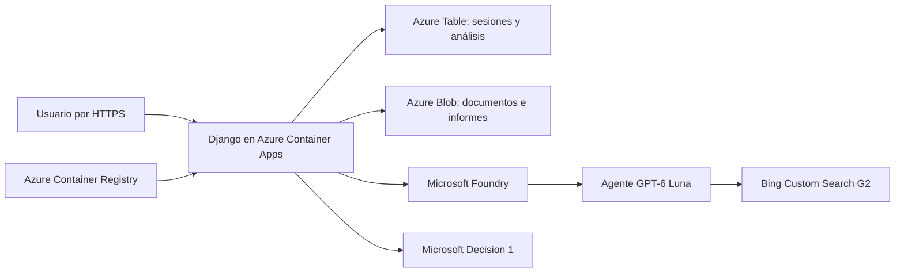

# Django Upgrade Evidence

Aplicación web para decidir si conviene actualizar una instalación de Django. Consulta fuentes oficiales, permite revisar los avisos por versión y genera un informe con la conclusión, la versión propuesta y los motivos. El informe se puede descargar en HTML o JSON.

## Requisitos

- Git, Python 3.11 o superior, [uv](https://docs.astral.sh/uv/), Azure CLI y Azure Developer CLI (azd 1.34.2 o compatible).
- Una suscripción de Azure con permisos para crear un grupo de recursos, desplegar sus servicios y asignar roles en él. Usa una cuenta de usuario de Microsoft Entra para inicializar el acceso.
- Cuota para GPT-6 Luna y Microsoft Decision 1 en la región elegida, y acceso a Bing Custom Search G2. La plantilla usa West Europe en el ejemplo.
- Presupuesto para Container Apps, Container Registry, Storage, Foundry y Bing. La imagen se construye en Azure Container Registry.

## Desplegar en Azure

Crea un entorno azd y un grupo de recursos exclusivos para la aplicación. Elige dos fechas ISO 8601 con zona horaria: el fin del consumo y la retirada de los recursos. Ambas deben ser futuras y el fin del consumo debe ser igual o anterior a la retirada.

```sh
git clone https://github.com/sboludaf/foundry-django-upgrade-evidence-lab.git
cd foundry-django-upgrade-evidence-lab
uv sync --frozen

az login
az account list --output table
printf 'ID de tu suscripción de Azure: '
read -r subscription_id
az account set --subscription "$subscription_id"
azd auth login

printf 'Nombre único del entorno: '
read -r environment_name
printf 'Fin del consumo (ISO 8601): '
read -r expires_at
printf 'Retirada de los recursos (ISO 8601): '
read -r cleanup_at

azd env new "$environment_name"
azd env set AZURE_SUBSCRIPTION_ID "$subscription_id"
azd env set AZURE_LOCATION westeurope
azd env set AZURE_RESOURCE_GROUP "rg-$environment_name"
azd env set AZURE_PRINCIPAL_ID "$(az ad signed-in-user show --query id --output tsv)"
azd env set LAB_EXPIRES_AT "$expires_at"
azd env set CLEANUP_AT "$cleanup_at"
azd env set PROVISION_GROUNDING true
azd env set SOURCE_COMMIT "$(git rev-parse HEAD)"

azd provision --preview --no-prompt
```

Revisa la vista previa. Cuando corresponda al grupo y a la suscripción elegidos, ejecuta:

```sh
azd provision --no-prompt
azd deploy web --no-prompt
```

Cada entorno crea su propio proyecto de Foundry, sus modelos, su configuración de Bing para Django y PyPI, y sus servicios de almacenamiento y alojamiento.

## Crear el usuario y abrir la aplicación

Desde la raíz del repositorio y con el mismo entorno azd seleccionado:

```sh
uv run python scripts/owner.py
app_url="$(azd env get-value SERVICE_WEB_ENDPOINT_URL)"
printf '%s\n' "$app_url"
curl --fail --silent --show-error "${app_url%/}/health/"
```

El script pide el nombre de usuario y una contraseña de al menos 16 caracteres por entrada protegida. Abre la URL mostrada e inicia sesión con ese usuario. Para utilizar el cliente interactivo con la misma cuenta:

```sh
uv run python scripts/client.py --url "$app_url"
```

## Generar un informe

1. Introduce una versión exacta de Django, por ejemplo `5.2.18`, y pulsa **Preparar lote oficial**.
2. Pulsa **Buscar con Bing y extraer evidencia** para obtener la propuesta de avisos.
3. En la tabla, confirma o corrige cada aviso. Si marcas una condición como cumplida o descartada, registra la observación de tu entorno. Guarda los avisos confirmados.
4. Pulsa **Calcular conclusión del informe**. Verás la versión instalada, la versión propuesta cuando corresponda y los motivos. La conclusión puede ser **Actualización indicada**, **No indicada con la evidencia disponible** o **Evidencia insuficiente**.
5. Descarga el informe en HTML o JSON desde la misma página.

## Arquitectura



La aplicación usa una identidad administrada para acceder al almacenamiento y a Foundry. Azure gestiona las claves de Django y Bing. La configuración de cada instalación queda en el entorno azd local.

## Retirar la instalación

Selecciona el entorno que creaste, comprueba su grupo de recursos y ejecuta la retirada al terminar. `CLEANUP_AT` etiqueta el grupo con la fecha prevista.

```sh
azd env select "$environment_name"
azd env get-value AZURE_RESOURCE_GROUP
azd down
```

Los fragmentos de Django conservan su [licencia](docs/DJANGO-LICENSE).
