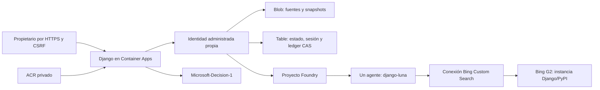

# Arquitectura desplegada

Cada entorno azd usa un grupo exclusivo; nombres de hijos derivados del grupo/entorno. Autor y Tester no comparten IA, Storage, identidad o web.

Recursos comprobados en Azure el09/11/2026: AIServices/proyecto, despliegues django-luna y django-decision, Bing.GroundingCustomSearch G2/global, configuración django-official y conexión ApiKey GroundingWithCustomSearch, ACR Basic, Storage LRS(Blob evidence y Table mvpstate), UAMI/roles propios, Container Apps Environment y web. No Log Analytics ni app registration Entra.

El aprovisionamiento configuró Bing y la conexión; el agente creado conserva el modelo django-luna y la herramienta bing_custom_search. Crear recursos no prueba la respuesta: el recorrido real y el SHA servido se comprueban por separado. Ninguna revisión hereda QA.

El navegador sólo llama al backend. La UAMI accede a sus recursos por Entra; la clave Bing permanece en la conexión gestionada por Azure y no llega al navegador ni a outputs. Django usa un secreto del recurso, el propietario un hash en Table y sesiones revocables de una hora. No hay registro público.

CLEANUP_AT/LAB_EXPIRES_AT se fijan desde el plan propio. En una actualización de infraestructura, SERVICE_WEB_IMAGE conserva la imagen real actual; el primer provision puede usar la imagen inicial hasta que deploy publica el producto. /health/commit identifica la imagen efectiva.

[Configuración y diagnóstico Bing](bing-setup.md).
