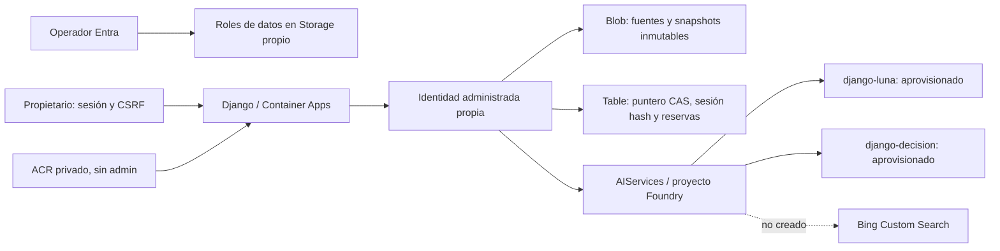

# Arquitectura desplegada r3 y corrección preparada r4

Grupo propio Implementer: rg-mvp-django-20261105-impl; otra instalación debe usar otro grupo/entorno azd. Azure crea nombres de hijos distintos a partir de ambos identificadores.

Recursos comprobados por ARM: AIServices/proyecto, despliegues django-luna y django-decision, ACR Basic, Storage LRS con Blob evidence y Table mvpstate, identidad de runtime, roles scoped, entorno Container Apps y recurso web. No Log Analytics ni registros de aplicación Entra.

La lectura de recursos no prueba inferencia ni compatibilidad. El despliegue de la imagen se comprueba aparte por /health/.commit, revisión Container Apps e imagen ACR; la disponibilidad actual no se infiere de una captura histórica. Ninguna revisión hereda QA.

El frontend llama sólo a su backend por HTTPS; tokens Azure/Bing no llegan al navegador. Clave Django en secretos del recurso, contraseña sólo como hash Table, sesiones de una hora revocables por generación. No hay registro público.

Bing sigue como integración requerida sin sustitución. La evidencia HTTP es un complemento auténtico con fecha/hash. El resultado final requiere agente, grounding, revisión y Decision-1 reales.

La corrección r4 prepara cuenta Custom Search G2 con API2020-06-10, instancia django-official por ARM2025-05-01-preview y conexión posterior. Es código preparado, no un servicio ya creado. El último despliegue comprobado sirve el SHA1760bb14f44f8b28c3cba7885451191b066a795d; todavía no sirve las correcciones r4. [Contrato y diagnóstico Bing](bing-setup.md).
