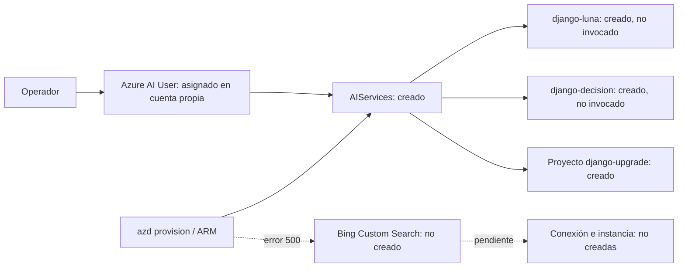

# Arquitectura al 05/11/2026

Este diagrama se acredita con readbacks ARM y `provisioning-evidence.json`. No representa llamadas de análisis ni una aplicación web en Azure.

Objetivo pendiente: navegador autenticado → Container Apps → agente Luna + Bing Custom Search → revisión/comparador → Decision-1 → informes HTML/JSON. Blob/Table conservarán etapas, evidencia y ledger; ACR servirá la imagen. Esos componentes de hosting, datos y producto no están desplegados ni acreditados. Una futura copia Tester usará otro grupo y otros recursos.
